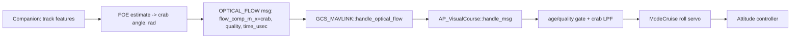

# EKF3 / Plane: Non-GPS Cruise Course-Hold via Forward Optical Flow — Implementation Plan

Date: 2026-10-17
Branch: `Plane-4.5.4-uavnav-estimator`
Scope: `ArduPlane`, `libraries/AP_OpticalFlow`, `libraries/GCS_MAVLink`, new `libraries/AP_VisualCourse`

Companion document (observations + full estimator upgrade proposal):
[`docs/ekf3-fixedwing-nongps.md`](./ekf3-fixedwing-nongps.md)

This document consolidates the design decisions and the actionable task list for a
**non-GPS CRUISE mode that holds course using a front-facing camera's optical flow**,
delivered over the MAVLink `OPTICAL_FLOW` message.

---

## 1. Design summary (decided)

1. **Hold the ground course (heading + crab) at the locked value.** The camera measures
   the crab angle (ground-velocity direction relative to the nose); combining it with the
   AHRS heading gives the ground course. *Nulling* the crab alone has no equilibrium in
   crosswind and must not be used.
2. **Depth-free control loop.** The roll servo closes on *course* error and rate
   (`course = heading + crab`), and the crab angle arrives already estimated by the
   companion, so the FC needs no depth at all. A rangefinder is **not required**; depth is
   only relevant to the companion's FOE estimate and to any future metric outputs.
3. **Crab angle ≠ sideslip.** The camera measures **crab** (course − heading). Aerodynamic
   sideslip needs air data. Course-hold only needs crab.
4. **Crab estimation on the companion (R1).** The companion sends the FOE-derived crab
   angle (rad, body frame, + = drifting right) in `flow_comp_m_x`, plus quality and the
   mid-exposure timestamp. The FC filters it; mount rotation / gyro compensation / flow
   integration move to the companion. *(Supersedes the earlier "rotation compensation on
   the FC" plan.)*
5. **Camera intrinsics live on the companion only.** The companion converts pixel flow →
   angular flow and estimates the FOE/crab angle using its own intrinsics; the FC receives
   only the crab angle and needs no intrinsics or mount orientation.
6. **Source selection — GPS preferred, visual fallback.** Do not replace the existing
   GPS lock. At lock time, check which source is available and use it:
   - GPS has a fix (`fix_type >= AP_GPS::GPS_OK_FIX_2D`) → lock to GPS course (unchanged).
   - Else visual course is healthy → lock to visual (FOE-centered) course.
   - Else → do not lock.
7. **Mount orientation lives on the companion.** The camera mount rotation is applied by
   the companion so the crab arrives in the body frame. The FC has no orientation parameter
   (`VC_ORIENT` was removed) and does not apply any mount rotation.
8. **Reuse the stock `OPTICAL_FLOW` MAVLink message** (no new message). `flow_comp_m_x`
   carries the FOE crab angle (rad); `quality` the confidence; `time_usec` the mid-exposure
   timestamp in the FC time domain.
9. **Angular-only for now.** No depth source in the initial scope. The control loop and
   crab-angle filter are fully angular; metric lateral velocity / depth is deferred.
10. **TIMESYNC is required.** The companion timestamps each sample (mid-exposure) in the
    FC time domain using MAVLink `TIMESYNC`. The crab filter relies on sample timing for
    its rate estimate and age gate. Stamps that are zero, lead the FC clock by more than
    `VC_SYNC_MS`, or lag it by > 10 s are treated as unsynced and the receipt time is used
    instead (P2.8).

### Data flow



### Core math

- Crab angle (computed on the companion from the FOE, sent in `flow_comp_m_x`):
  $$\text{crab} = \text{course} - \psi \approx \arctan\!\left(\tfrac{\text{foe}_x - c_x}{f_x}\right) \approx \arctan\!\left(\tfrac{\text{flow}_{lat}}{\text{divergence}}\right)$$
  Depth cancels only in the lateral/divergence ratio; integrating $\text{flow}_{lat}$ alone
  does **not** give the crab angle (R1).
- Ground course:
  $$\text{course} = \psi + \text{crab}$$
- Roll command (PD on course error vs the locked course):
  $$\text{roll} = -K_p \cdot \text{wrap}(\text{course} - \text{course}_{lock}) - K_d \cdot (\dot\psi + \dot{\text{crab}})$$

### Sign conventions (authoritative)

All angles in radians unless noted; body frame is right-handed with **X = nose, Y = right,
Z = down**. Heading/yaw (`ψ`) and course are measured clockwise from north (east positive),
the same convention as `ahrs.get_yaw()`.

| quantity | definition | positive |
|---|---|---|
| `crab` | angle from the nose (body X) to the ground-velocity vector, about body Z | **+ = drifting right** (velocity to the right of the nose) |
| `course` | `ψ + crab` | + = clockwise (east of north positive) |
| `course_error` | `wrap(course − course_lock)` | + = track right of the locked course |
| `course_rate` | `yaw_rate_earth + crab_rate` | + = course increasing (turning right) |
| `roll_cmd` | bank command | + = right roll (standard) |

- **Crab on the wire:** `OPTICAL_FLOW.flow_comp_m_x` carries `crab` (rad, body frame,
  + = drifting right). The companion derives it as `crab ≈ atan2(v_b,y, v_b,x)`, which
  inherits the body-frame right-handed convention (Y = right).
- **Servo:** `roll_cmd = −(Kp·course_error + Kd·course_rate)`. A positive course error
  (off to the right of lock) commands left roll to steer back; the derivative term opposes
  course rate for damping.
- **SITL ground truth** (`AP_VisualCourse::update_sitl`):
  `crab = wrap_PI(atan2(speedE, speedN) − radians(yawDeg))` — matches + = right drift.

---

## 2. Task list

### Phase 0 — Message contract & parameters

- [x] **P0.1** Freeze the `OPTICAL_FLOW` field mapping (reusing the stock message):
  - `flow_comp_m_x` = FOE crab angle (rad, body frame, + = drifting right)
  - `quality` = 0–255 confidence
  - `ground_distance` = 0 (or forward rangefinder if present)
  - `time_usec` = mid-exposure timestamp (FC time domain via TIMESYNC)
  *(Updated for R1: the raw `flow_x/flow_y`/`flow_rate_*` fields are no longer used by the FC.)*
- [x] **P0.2** ~~Define the FC-side mount orientation (`VC_ORIENT`, a `Rotation`).~~
  *(Superseded by R1/R13: orientation moved to the companion and `VC_ORIENT` removed.)*
- [x] **P0.3** Define gains and limits: `VC_GAIN_P`, `VC_GAIN_D`, `VC_QUAL_MIN`,
  `VC_TIMEOUT_MS`, `VC_FORCE`, `VC_SYNC_MS`. Reuse existing airspeed params (`AIRSPEED_MIN`,
  `AIRSPEED_CRUISE`) — no `VC_MIN_AIRSPEED`.
- [x] **P0.4** Document sign conventions. *Done: §1 "Sign conventions" — crab
  + = drifting right, `course = ψ + crab`, `roll = −(Kp·err + Kd·rate)`.*
- [x] **P0.5** Specify timestamp domain: `time_usec` = mid-exposure time in the **FC time
  domain** (via `TIMESYNC`). Define max allowed sync error (e.g. 10 ms) for `healthy()`.
  *Done (P2.8): `VC_SYNC_MS` (default 10 ms) bounds how far a stamp may lead the FC clock.*

### Phase 1 — Companion-side flow estimation (external)

- [ ] **P1.1** Implement flow estimation in camera frame (pixel displacement per frame).
  Recommended: sparse KLT feature tracking (or multi-block phase correlation) to get a
  flow field + FOE estimate. Single global phase correlation is acceptable only for the
  first prototype (biased in turns/depth-varied scenes).
- [ ] **P1.2** Convert pixel flow → angular flow using intrinsics
  (`flow_rad = flow_px / f / dt`); do **not** subtract rotation.
- [ ] **P1.3** Emit quality metric (track count / inlier ratio / blur → 0–255).
- [ ] **P1.4** Emit mid-exposure timestamp and raw camera gyro (if synced IMU exists).
- [ ] **P1.5** Leave `ground_distance` zero unless a forward rangefinder is present.
- [ ] **P1.6** Companion runs `TIMESYNC` and stamps `time_usec` as mid-exposure time in the
  FC timebase.

### Phase 2 — `AP_VisualCourse` library (new)

- [x] **P2.1** Create `libraries/AP_VisualCourse/` skeleton (front-end + config header),
  modeled on `AC_PrecLand` / `PosVelEKF`.
- [x] **P2.2** `handle_msg()` — decode `mavlink_optical_flow_t`, store latest
  crab/quality/timestamp (crab contract after R1).
- [x] **P2.3** `update()` — apply mount `Rotation` to map sensor → body axes.
  *(Superseded by R1: mount rotation moved to the companion.)*
- [x] **P2.4** ~~`update()` — rotation compensation using message gyro if synced, else
  `ahrs.get_gyro()`.~~ *Superseded by R1: the FC no longer compensates rotation — the
  companion sends the compensated crab angle.*
- [x] **P2.5** `update()` — crab-angle filter (crab, crab rate).
  *Done via R1: `process_new_sample()` low-passes the crab angle (0.05 s) and crab rate
  (0.1 s); a full prediction/correction filter is not needed for the angle-only contract.*
- [x] **P2.6** ~~Optional metric lateral velocity.~~ *Dropped (R16): needs ground speed,
  which is unavailable without GPS; airspeed·sin(crab) is wrong in wind.*
- [x] **P2.7** Health gating: quality ≥ `VC_QUAL_MIN`, message age ≤ `VC_TIMEOUT_MS`.
  *(The airspeed ≥ `AIRSPEED_MIN` gate lives in the CRUISE lock condition, not `healthy()`.)
  Fixed 2026-10-17: `VC_QUAL_MIN` was an `AP_Int8`, so values > 127 wrapped negative and
  disabled the gate; now `AP_Int16`.*
- [x] **P2.8** Validate `time_usec` against `TIMESYNC` freshness; reject/de-weight when
  clock offset exceeds the configured limit.
  *Done (2026-10-17):* `handle_crab_sample()` classifies each stamp by its latency vs the
  receipt time: synced if `−VC_SYNC_MS ≤ latency ≤ 10 s`, otherwise (zero, ahead of the FC
  clock, or a foreign timebase) it falls back to the receipt time and sends a rate-limited
  GCS warning; `VC.Sync` logs the state. The age gate is now signed. Also fixed the crab
  rate: it used the 50 Hz scheduler dt and differenced against the filtered crab (≈ 2× too
  high with a 25 Hz camera); it now uses the spacing of sample timestamps and the previous
  raw sample, skips duplicate/out-of-order samples, and re-initialises after a gap.
  Verified by injecting stamps 1 s ahead / zero / ~1e15 (all flagged) and a synced
  30 ms-latency stamp (accepted); canonical and `--gps-off` regressions unchanged.*
- [x] **P2.9** Getters: `healthy()`, `crab_angle()`, `crab_rate()`. `lateral_velocity_b()`
  dropped (R16).*

### Phase 3 — GCS routing

- [x] **P3.1** Add a call in `GCS_MAVLink::handle_optical_flow()` (or a parallel handler)
  to forward `OPTICAL_FLOW` to `AP_VisualCourse`, keeping the existing `AP_OpticalFlow`
  down-flow path intact.
- [x] **P3.2** Register the `AP_VisualCourse` singleton on `Plane` (params, init, update
  scheduling).

### Phase 4 — CRUISE mode integration (`ArduPlane/mode_cruise.cpp`)

- [x] **P4.1** Add an either/or lock source in `ModeCruise::navigate()` — keep the
  existing GPS branch, and add a visual fallback branch:
  - GPS available (`gps.fix_type >= AP_GPS::GPS_OK_FIX_2D`): use GPS course (unchanged).
  - Else visual course healthy + airspeed ≥ `AIRSPEED_MIN` + moving forward: use
    visual course.
- [ ] **P4.2** Lock heading from `ahrs.get_yaw()` (or FOE-centered heading if no compass).
  *Partial: no FOE-heading fallback without compass.*
- [x] **P4.3** In `ModeCruise::update()` locked branch, replace `calc_nav_roll()` with the
  PD course servo (`course_error = wrap(heading − locked_heading + crab)`, negative roll
  for positive course error), clamped to roll limits.
- [x] **P4.4** Keep `update_fbwb_speed_height()` for throttle/pitch.
- [x] **P4.5** Prefer GPS `calc_nav_roll()` when GPS is healthy; use the visual course servo
  only when GPS is unavailable (non-GPS fallback), or always when `VC_FORCE=1`.
- [x] **P4.6** Unlock heading on aileron/rudder input **and** on visual dropout
  (revert to manual roll). *Done via R10 (level wings ≤ 1 s, then unlock).*

### Phase 5 — Logging & SITL

- [x] **P5.1** Add `VC` log message. *Done (R15): crab, crab_rate, quality, healthy, plus
  course error, roll command and autotune state. "Compensated lateral flow" is moot after
  R1 (no raw flow on the FC).*
- [x] **P5.2** Add a SITL backend (mirror `AP_OpticalFlow_SITL`) that synthesizes
  `OPTICAL_FLOW` from the simulated camera pose.
  *Done (2026-10-17):* `update_sitl()` now packs the true crab into a real
  `mavlink_optical_flow_t` (flow_comp_m_x = crab, quality = 255, time_usec = now) and
  feeds it through `handle_msg()`, so the SITL path exercises encode → decode → filter
  exactly like a real message. Airborne canonical test PASS (max|dev| 1.27°, std 0.39°).*
- [x] **P5.3** SITL test: verify sign convention and course-hold behavior under
  simulated wind. *(Rotation compensation moved to the companion in R1.)*
  - *Airborne (2026-10-17):* GPS-on 1.27° max; GPS-off (R3) 2.06° max over ~5 min.
    Earlier "~6°" numbers were measured while taxiing (harness bug, §5.1).

### Phase 6 — EKF crab-angle / forward-flow fusion (optional, from upgrade U1)

Angle-only crab is a genuinely new, GPS-independent observation of the ground-velocity
**direction**. It directly corrects lateral velocity / lateral wind and, over maneuvers
(wind triangle), makes wind + ground speed observable — but a single crab sample only
constrains wind to a line; along-track wind / ground-speed magnitude need heading change
or a depth source (D1). No EKF change is required for the course-hold feature itself.

*SITL finding (R3, 2026-10-17):* GPS-denied CRUISE held the true course within ~2° for
~5 min with no EKF changes; AHRS yaw stayed within 1.1° of truth. **Phase 6 is not
required for course hold.** It remains optional for position / wind / ground-speed
estimation without GPS (EKF dead-reckoned 54 m in 5 min).

- [ ] **P6.1** Add a forward-facing flow / crab-angle measurement model in
  `AP_NavEKF3_OptFlowFusion.cpp`. Start with the angle-only form (1-DOF nonlinear
  observation of velocity direction vs body X), no depth required.
- [ ] **P6.2** Relax hover-only gates in `SelectFlowFusion()` / `EstimateTerrainOffset()`.
- [ ] **P6.3** Add `EK3_FLOW_*` / `FLOW_USE` forward-cruise bits.
- [ ] **P6.4** Fuse lateral velocity / wind so `status.flags` stops reporting pure
  dead-reckoning while flow is valid.

### Phase 7 — Flight test plan

- [ ] **P7.1** Ground/SITL validation of loop stability and sign.
- [ ] **P7.2** Cruise at 10–20 m/s, no GPS, verify course holds under crosswind.
- [ ] **P7.3** Tuning strategy for `VC_GAIN_P/D`:
  - First: analytic gain scheduling on airspeed (plant gain ∝ `g/V`), no autotune required.
  - Then optionally: autotune to calibrate the nominal bandwidth and altitude (depth-proxy)
    scaling.
- [ ] **P7.4** Verify GPS fallback and visual-dropout behavior.
  *SITL done (R10/R11 verified airborne); hardware flight test pending.*
- [x] **P7.5** Implement `VC_AUTOTUNE` — relay excitation (Ziegler-Nichols on the limit
  cycle) to calibrate `VC_GAIN_P/D` in flight.
  *Validated airborne (2026-10-17):* from `Kp=0.8, Kd=0` in an 8 m/s crosswind at ~20 m/s
  the relay (±20° roll, actual ±27°) completes in ~8 s and saves `Kp≈4.0–4.4,
  Kd≈1.0` (3 runs, ±10 %) plus `VC_AS_REF`; the hold improves from 1.26° to **0.50° max
  (std 0.14°)**. Fixed along the way: the first (partial) relay cycle was counted as a full
  period, and clamped gains were saved silently — the completion message now says
  `CLAMPED` (WARNING severity) when the safe band is hit.*

### Phase 8 — Review follow-ups (2026-10-17)

**Critical (real-camera path not yet correct)**

- [x] **R1** Fix crab estimation. `∫ flow_lat dt` is not the crab angle (lateral flow is
  ≈ `(V/d)·crab`). Change the contract so the companion sends the FOE-derived crab angle
  (rad) directly in a float field (e.g. `flow_comp_m_x`), or switch to `OPTICAL_FLOW_RAD`
  (integrated rad + integration time + integrated gyro). Update P0.1 accordingly.
  *Done (2026-10-17):* the companion sends the FOE crab angle (rad, body frame,
  + = drifting right) in `flow_comp_m_x`. `handle_msg()` decodes it into
  `handle_crab_sample()`; `update_from_flow()` was removed in favour of
  `process_new_sample()` (LPF on crab angle and crab rate). Mount rotation / gyro
  compensation / flow integration move to the companion; `_latest` now stores `crab`
  instead of raw flow fields.
- [x] **R2** Real SITL backend: synthesise raw flow messages (rotation, latency, noise) from
  truth and feed them through `handle_msg()`, so decoding, mount rotation, gyro
  compensation and timing are actually exercised.
  *Done (2026-10-17):* superseded by R1 — the message now carries crab, not raw flow, so
  `update_sitl()` synthesises the true crab `wrap_PI(course_true − heading_true)` and
  routes it through `handle_crab_sample()`, exercising the shared age/quality/filter path
  that a real message would (P5.2 later completed the full encode → `handle_msg()` path).
  Also fixed a critical latent bug: the constructor was missing
  `AP_Param::setup_object_defaults(this, var_info)`, so every VC param defaulted to 0
  (incl. `VC_TIMEOUT_MS=0` → never healthy). *(The 6.8° / 35.7° re-test numbers were
  measured while taxiing; see §5.2 for airborne baselines.)*
- [x] **R3** Re-run the GPS-disabled SITL flight with the corrected course law; decide
  whether Phase 6 is required.
  *Done (2026-10-17):* `visualcourse_cruise_test.py --gps-off --duration 60` (≈ 5 min sim,
  `VC_FORCE=0`, GPS disabled before CRUISE, truth from `SIMSTATE`). Airborne at 62–64 m,
  true airspeed 10–12 m/s, 8 m/s crosswind → crab −35…−49°. **True course held within
  2.06° (std 0.57°)**, AHRS yaw error ≤ 1.1°, stayed in CRUISE; EKF position drifted 54 m
  (dead reckoning, irrelevant to course hold). **Decision: Phase 6 is not required for
  course hold** — the loop only needs compass-aided yaw + crab. Caveats: SITL compass is
  ideal (real yaw error maps 1:1 into course error) and the SITL crab is perfect truth.*
- [x] **R4** Fix health flicker: health from message age; update the filter only on new
  data (50 Hz scheduler vs 20–30 Hz camera currently toggles `healthy()` every tick).
  *Done: `healthy()` now decays with message age; the filter runs only when a new message
  arrives.*
- [x] **R5** Fix non-Plane builds: move `OPTICAL_FLOW` routing from `GCS_Common.cpp` into
  `ArduPlane/GCS_Mavlink.cpp` (library is only linked into Plane). Verify Copter/Rover build.
  *Done: visual-course forwarding moved into `GCS_MAVLINK_Plane::handle_message`; Copter
  builds and links.*
- [x] **R5b** Pre-arm check: reject `VC_ENABLE=1` together with `FLOW_TYPE=5` (MAVLink),
  otherwise EKF3 fuses the repurposed values as down-facing flow.
  *Done: added in `AP_Arming_Plane::pre_arm_checks`; also added `AP_OpticalFlow::get_type()`.*

**Important**

- [x] **R6** ~~Time-aligned rotation compensation: buffer FC gyro, subtract its integral
  over the frame interval ending at `time_usec`; use signed age so a companion clock ahead
  of the FC doesn't wrap to "stale forever"; use or drop the stored camera gyro fields.~~
  *Moot after R1: rotation compensation and flow integration moved to the companion. The
  remaining timestamp concern is the age gate and crab-rate estimate (see Gotchas).*
- [x] **R7** Autotune safety: reset on unlock / VC unhealthy; abort on roll, altitude or
  course excursion; relay hysteresis; clamp saved gains; remove unused `dt` and the
  function-local `static` timer in `mode_cruise.cpp`.
  *Done (2026-10-17):* added `autotune_reset()` (on unlock and VC dropout) and
  `autotune_abort(reason)` (roll > 50°, altitude deviation > 30 m from the start, course
  error > max(45°, 2·amp), or airspeed < 10 m/s mid-run). The relay now has ±1° hysteresis
  and won't start until airspeed ≥ 12 m/s (aileron authority); learned gains are clamped
  to Kp ∈ [0.05, 5], Kd ∈ [0, 3]. The unused `dt` parameter and the `static` timer in
  `mode_cruise.cpp` were removed. *Verified airborne (2026-10-17, `SIM_SPEEDUP=1`):
  roll-stick unlock mid-relay → `ATun` drops to 0 with periods discarded and
  `VC_AUTOTUNE` still 1 → relock restarts and completes; pitch stick held down mid-relay
  → "autotune aborted: altitude excursion", `VC_AUTOTUNE=0`, gains left at 0.8/0.*
- [x] **R8** D-term: use earth-frame yaw rate (`ahrs.get_yaw_rate_earth()`) instead of body
  `gyro.z`, and a heavier filter on the vision crab rate.
  *Done (2026-10-17):* servo now uses `get_yaw_rate_earth() + vc.crab_rate()`; crab rate
  is low-passed inside `process_new_sample()` (0.1 s time constant).*
- [x] **R9** Airspeed gain scheduling: scale autotuned gains by `V / V_tune` (P7.3).
  *Done (2026-10-17):* added `VC_AS_REF` (reference airspeed, 0 = off). The CRUISE servo
  scales Kp/Kd by `VC_AS_REF` clamped to [0.5, 2] via `gain_scale()`; the autotuner saves
  the tune airspeed into `VC_AS_REF` on completion.*
- [x] **R10** Dropout policy: level wings for ≤1 s, then unlock with a GCS message (P4.6).
  *Done (2026-10-17):* on visual dropout the wings level and, after 1 s of continuous
  dropout, CRUISE unlocks and sends "VisualCourse: dropped out, heading unlocked".
  *Verified airborne (2026-10-17, `SIM_SPEEDUP=1`, dropout forced via `VC_ENABLE=0`): a
  0.4 s dropout levels the wings and resumes the lock with no message (course within
  1.6°); a sustained dropout unlocks after 1.04 s with wings level throughout. With GPS
  available CRUISE then re-locks on GPS (visual is unhealthy, so `VC_FORCE` does not apply).*
- [x] **R11** GPS ↔ visual handover while locked (GPS lost on GPS lock → switch to visual;
  GPS back on visual lock → optionally switch back).
  *Done (2026-10-17):* the locked branch re-evaluates the source each tick. GPS lost →
  re-lock to the current ground course on visual (unless `VC_FORCE`); GPS restored →
  re-lock to the GPS course and resume `calc_nav_roll()`. *Verified airborne (2026-10-17,
  `SIM_SPEEDUP=1`, `VC_FORCE=0`): GPS lock → `SIM_GPS_DISABLE=1` → "GPS lost, using visual
  course", true course within 1.1° over 25 s → GPS restored → "GPS restored, using GPS
  course", within 2.9° over 25 s; stayed in CRUISE throughout.*
- [x] **R12** `get_target_heading_cd()` should report the locked course for the visual path.
  *Done (2026-10-17):* `locked_heading_cd` already holds the ground course for both paths;
  documented in `get_target_heading_cd()`.*

**Housekeeping**

- [x] **R13** Verify `VC_ORIENT` axis mapping (`flow_body.z` as lateral rate) once R2 exists.
  *Moot after R1/R2 — the FC no longer applies mount rotation or decodes raw flow. Removed
  the dead `VC_ORIENT` param (2026-10-17); params renumbered (GAIN_P=1 .. AS_REF=8).*
- [x] **R14** Update design summary items 1, 6 and the Gotchas to match the current law and
  `VC_FORCE`.
  *Done (2026-10-17):* design summary items 2/4/5/7/8/10 and the Gotchas now reflect the
  R1 crab contract (companion-side estimation, `flow_comp_m_x`).*
- [x] **R15** Extend `VC` log: compensated lateral flow, course error, roll command,
  autotune state.
  *Done (2026-10-17): added `CErr` (course error), `RollCmd`, `ATun` (active) and
  `ATunP` (periods) to the VC message. "Compensated lateral flow" is dropped (no raw flow
  on the FC after R1). `set_servo_state()` is called from CRUISE each tick.*
- [x] **R16** Implement or drop `lateral_velocity_b()` (P2.9 / P2.6).
  *Dropped (2026-10-17): it needs ground speed, unavailable without GPS, and
  airspeed·sin(crab) is wrong in wind. P2.6/P2.9 updated.*
- [x] **R17** Write the sign conventions into this doc (P0.4).
  *Done (2026-10-17):* §1 "Sign conventions" added; also fixed the missing minus sign on
  the roll-command formula.*

## 3. Deferred (not in initial scope)

- **D1** Depth source / metric lateral velocity — decided **angular-only for now**. Revisit
  later with a forward rangefinder or airspeed+divergence (time-to-contact) when metric
  outputs (EKF fusion, wind estimation) are needed.

---

## 4. Gotchas (revisit before each phase)

- The crab arrives in `flow_comp_m_x` (a float); the stock `flow_x/y` int16 "dpix" fields
  are unused by the FC — keep the down-facing `AP_OpticalFlow` path from consuming them
  (see R5b pre-arm check).
- TIMESYNC staleness corrupts the timestamp age gate and the crab-rate estimate; unsynced
  stamps fall back to receipt time (P2.8), which loses the camera-to-FC latency.
- Crab estimation (FOE) needs the lateral/divergence ratio — depth cancels only there. The
  companion must not integrate lateral flow alone (R1).
- Flow SNR collapses below ~3 m/s — keep the min-airspeed gate (`AIRSPEED_MIN`).
- Crab ≠ sideslip; do not feed crab into air-data logic expecting β.

---

## 5. SITL regression test & metrics

Reproduce the course-hold numbers from one command and catch regressions. **After every
change, re-run the canonical test and append a row to the table** so a slow drift is
visible and earlier results don't silently get worse.

### 5.1 How to run

```bash
./waf plane                                    # 1. build
Tools/scripts/visualcourse_sitl.sh             # 2. reset params + launch SITL with VC params
#   (add --autotune to also set VC_AUTOTUNE=1)

python3 Tools/scripts/visualcourse_cruise_test.py --port 5770   # 3. canonical test
python3 Tools/scripts/visualcourse_cruise_test.py --port 5770 --autotune  # relay-tune first
python3 Tools/scripts/visualcourse_cruise_test.py --port 5770 --gps-off --duration 60  # R3
```

`Tools/scripts/visualcourse_sitl.sh` removes `eeprom.bin`/`flash.dat` (reset to firmware
defaults) and launches SITL with the canonical parameter set from
`Tools/scripts/visualcourse.parm` via the `-P NAME=VALUE` option, so previous runs never
influence the result. The `.parm` file is the single source of truth for the launch
parameters.

The harness (`Tools/scripts/visualcourse_cruise_test.py`) sets `VC_ENABLE=1`,
`VC_FORCE=1`, `SIM_WIND_SPD=8`, `SIM_WIND_DIR=90`, calibrates the accelerometers, arms in
TAKEOFF mode (`TKOFF_ALT=70`), waits until the relative altitude (`GLOBAL_POSITION_INT`)
is within 10 m of target with climb < 1.5 m/s and airspeed ≥ 12 m/s, switches to CRUISE,
waits for the course to settle (~3 s within 3°), and then measures the GPS course for 18 s.
It prints a single `METRICS ...` line and exits `0` (PASS) or `1` (FAIL). GPS is only the
measurement reference — the visual loop actually steers because `VC_FORCE=1`.

`--gps-off` (R3) instead sets `VC_FORCE=0` and `ARSPD_USE=1`, holds the throttle stick at
mid (airspeed target ≈ 15 m/s) via RC override, disables GPS, enters CRUISE and measures
the true course from `SIMSTATE` positions, plus the AHRS yaw error and the EKF position
drift. Any "SIM Hit ground" message invalidates the run (exit 2).

> **SITL scenario pitfalls (2026-10-17):** `SIM_TERRAIN=0` is set in the `.parm` — with
> terrain on, a CRUISE lock towards the hills SW of CMAC flies into the ground at 60 m AGL.
> At `AIRSPEED_MIN` into an 8 m/s headwind, ground speed drops below the 3 m/s SITL flow
> cutoff and R10 (correctly) unlocks; hence the mid-stick airspeed in `--gps-off`.

> **Harness bug fixed (2026-10-17):** earlier versions armed in GUIDED + `NAV_TAKEOFF`
> (which does not climb on Plane 4.5) and gated on `VFR_HUD.alt` (AMSL, 584 m at home), so
> the "airborne" checks always passed and **all rows below marked *ground* were measured
> while taxiing**. Only the *airborne* rows are valid baselines.

### 5.2 Canonical test & regression gate

| condition | value |
|---|---|
| GPS | enabled (measurement only) |
| wind | 8 m/s from 90° (crosswind from the east) |
| gains | `VC_GAIN_P=0.8`, `VC_GAIN_D=0.0` |
| measurement | 18 s, 10 Hz GPS course |

Metrics: `lock` (first course), `max_dev`, `std`, `mean_abs`, `n`.

| date | code state | Kp / Kd | max\|dev\| | std | mean\|dev\| | n | note |
|---|---|---|---|---|---|---|---|
| 2026-10-17 | P2.8 head | 0.8 / 0.0 | **1.26°** | 0.41° | 0.85° | 904 | **airborne** — current baseline |
| 2026-10-17 | R7/P7.5 head, `--autotune` | 4.19 / 1.02 (autotuned) | **0.50°** | 0.14° | 0.12° | 903 | **airborne**, gains learned in-flight (CONFIG line still prints the pre-tune 0.8/0.0) |
| 2026-10-17 | P2.8 head, `--gps-off` 60 s | 0.8 / 0.0 | **1.73°** | 0.53° | 0.78° | 116 | **airborne**, GPS-denied, flat terrain, mid airspeed |
| 2026-10-17 | P5.2 head | 0.8 / 0.0 | 1.27° | 0.39° | 0.86° | 904 | airborne |
| 2026-10-17 | P5.2 head, `--gps-off` 60 s | 0.8 / 0.0 | 2.06° | 0.57° | 1.05° | 116 | airborne, GPS-denied (R3), terrain on, min airspeed |
| 2026-10-17 | R1+R2 head | 0.8 / 0.0 | 4.95° | 2.30° | 2.09° | 1080 | *ground* (invalid) |
| 2026-10-17 | R7 head | 0.8 / 0.0 | 4.32° | 1.97° | 2.61° | 904 | *ground* (invalid) |
| 2026-10-17 | pre-R1+R2 | 0.97 / 1.85 (autotuned) | 2.2° | 0.7° | — | — | *ground* (invalid) |
| 2026-10-17 | R1+R2 head | 4.07 / 0.97 (autotuned, dirty re-run) | 12.17° | 4.90° | 5.48° | 1055 | *ground* (invalid) |

**Regression gate** (untuned `Kp=0.8` case, GPS-on and `--gps-off`): `max_dev ≤ 15°`
**and** `std ≤ 5°` for a PASS. Treat a change that moves `max_dev`/`std` beyond ~2× the
current airborne baseline (1.26°/0.41° GPS-on, 1.73°/0.53° GPS-off) as a regression to
investigate before merging.

### 5.3 Autotune notes (R7 / P7.5)

- Airborne SITL autotune is repeatable: `Kp≈4.0–4.4, Kd≈1.0` at ~20 m/s; the relay
  takes ~8 s sim time (one discarded partial cycle + 3 measured cycles).
- Start from a straight, stable state at cruise speed (the relay waits for airspeed
  ≥ 12 m/s). Unlocking mid-relay restarts it; any abort disables `VC_AUTOTUNE` and keeps
  the previous gains.
- A `CLAMPED` completion means Ziegler-Nichols wanted gains outside Kp ∈ [0.05, 5],
  Kd ∈ [0, 3]; re-check `VC_AUTOTUNE_AMP` before trusting them.
- SITL gains reflect the SITL airframe and a perfect crab signal. Re-tune on hardware.

### 5.4 Confirm the visual loop is steering (not the GPS fallback)

Check the `VC` dataflash message: `Heal=1` throughout and `Crab` tracking the true crab
`GPS.GCrs − ATT.Yaw`.

```python
from pymavlink import mavutil
m = mavutil.mavlink_connection("logs/00000083.BIN")  # any airborne run
crs = yaw = None
while True:
    msg = m.recv_match(type=["GPS", "ATT", "VC"], blocking=False)
    if msg is None:
        break
    t = msg.get_type()
    if t == "GPS" and msg.Status >= 3:
        crs = msg.GCrs
    elif t == "ATT":
        yaw = msg.Yaw
    elif t == "VC" and crs is not None and yaw is not None:
        true_crab = ((crs - yaw + 180) % 360) - 180
        assert msg.Heal == 1
        print(f"{msg.TimeUS*1e-6:.2f} crab={msg.Crab:.3f} true={true_crab:.1f}")
```
